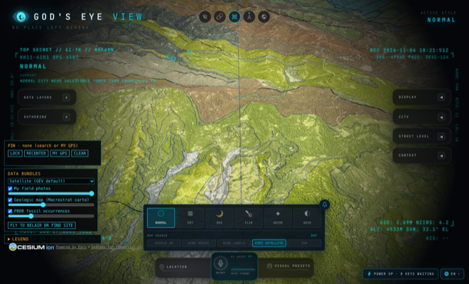
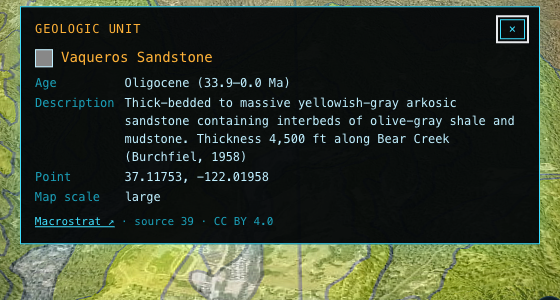
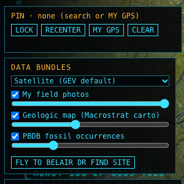

# Geo Recon hub

A 3D field map for **rockhounds and fossil hunters**. It runs on your laptop in a browser.

Geo Recon puts the rocks under your feet on a 3D globe: geologic map units, known fossil occurrences, museum specimens, and the photos and object scans you take in the field with the [Geo Recon phone app](https://github.com/dyodji/geo-recon-app). It started as a fossil hunt for giant Miocene oysters near Scotts Valley, California, so the default data covers the Santa Cruz Mountains.



## What it does

- **Geologic map overlay.** Macrostrat carto tiles over the terrain. Each color is one map unit (rock formation). Zoom 6-14 is cached for offline use. Opacity has a slider.
- **Click a rock unit for details.** You get the formation name, age range, lithology, description and source, from Macrostrat. Formations link to a short Wikipedia summary when one exists.

  

- **Fossil occurrences.** A snapshot of about 725 Paleobiology Database (PBDB) occurrences around Scotts Valley. Click one for the taxon, its common group, age and reference. A live PBDB proxy fills in more details.
- **Museum specimens and names.** iDigBio specimen records and the Macrostrat strat-name lexicon add context to a fossil or a formation.
- **Your field photos.** Photos from the phone land on the map as amber pins with a 25 m heading cone. Click one to see the photo.
- **Object scans for photogrammetry.** The phone's guided scan uploads a full frame set (ARCore poses and camera intrinsics) to the hub, ready for a structure-from-motion pipeline. The fossil detail panel has a slot for a 3D model; the `fossil3d` viewer fills it once integrated.
- **Current pin.** Search an address or use GPS. Lock the zoom, recenter, or clear. The phone has the same pin.
- **Basemaps and opacity.** Satellite, OpenStreetMap streets or CARTO dark (Esri streets, topo and dark gray with an ArcGIS key). Each layer keeps its own saved opacity.
- **Data Bundles.** Optional data packs you add or remove from the command line, so the core app stays small.

  

**Not in the screenshots.** The fossil and field-photo pop-ups, the legend, and the 3D slot were not captured for this README. They need a clean click on a point in the headless browser we used, and we did not get one. Check them in your own browser.

## Quick start

You need Node.js 24.x (24.14.0 or later) or 26.x.

```bash
git clone https://github.com/dyodji/geo-recon-hub.git
cd geo-recon-hub
git checkout geo-recon
npm ci
cp .env.example .env            # optional keys; never commit .env
npm run bundle -- defaults      # geology, PBDB fossils, field captures
npm run dev                     # http://localhost:4173
```

1. Close the first-run dialog.
2. In **DATA BUNDLES** (bottom left), click **FLY TO BELAIR DR FIND SITE**.
3. If the geology colors do not show, open **VISUAL PRESETS** and pick **ESRI SATELLITE** or **OSM** under **MAP SOURCE**. Google 3D tiles cover the draped geology.
4. Click a colored area to see its rock unit.

### Phone uploads (ingest service)

The ingest service is a separate small server on the LAN. The globe itself stays on loopback.

```bash
npm run ingest                  # LAN port 4180
```

Open http://127.0.0.1:4180/pair on the laptop and scan the QR code with the phone app. Details: [BUNDLES.md](BUNDLES.md#phone-upload-ingest-service).

### Bundle commands

```bash
npm run bundle -- list          # what is available, installed, enabled
npm run bundle -- add <id>      # install and enable
npm run bundle -- remove <id>   # delete files and state
```

| Bundle | Default | License |
|---|---|---|
| `geology-scotts-valley` | installed | Macrostrat CC BY 4.0; USGS public domain |
| `pbdb-fossils` | installed | PBDB CC BY 4.0 |
| `field-captures` | installed | your own photos |
| `telegeography-submarine-cables` | not installed | **CC BY-NC-SA 3.0** |
| `bhote-koshi-event-pack` | not installed | **CC BY-NC 4.0** |

## Rules in the field

Data on a map is not permission to dig. Collecting on public land, road right-of-way, parks and private land each has its own rules. Get permission first. Many precise fossil localities are withheld on purpose; respect that.

## How we built it

Geo Recon is a fork of [**God's Eye View**](https://github.com/bilawalsidhu/gods-eye-view) by Bilawal Sidhu (MIT). God's Eye View is a browser 3D globe on CesiumJS with a Vite front end, a small Node server that keeps API keys local, and many live data layers.

**What we use from God's Eye View**
- The CesiumJS globe, terrain, imagery and photorealistic 3D tiles.
- The app shell: panels, map source chips, visual presets, search, the settings and key broker.
- The local server, its proxy pattern and loopback-only security model.
- The test runner, formatter and build tooling.

**What we added**
- `bundles/`, `scripts/bundle.mjs`, `src/bundles/runtime.js`: the Data Bundles system and its layers (geology imagery, PBDB points, field-capture pins, object scans).
- `src/georecon/`: current pin, geologic unit lookup, fossil info and 3D slot, legend, layer opacity prefs, left dock, modal.
- `server/georecon/`: the PBDB proxy.
- `server/ingest/`: the LAN ingest service for phone photos and object-scan sessions (pairing token, PUT by id, LAN-only guards).
- Non-commercial data moved out of core into optional bundles.

**What we removed or reduced.** Some upstream features we do not need (for example typed chat and parts of the voice UI) are trimmed on this branch. The upstream layers that remain still work.

For the upstream feature set (live aircraft, ships, satellites, voice control and more), read the [God's Eye View README](https://github.com/bilawalsidhu/gods-eye-view#readme) (local copy: [docs/UPSTREAM-README.md](docs/UPSTREAM-README.md)).

## Maintenance plan

**Branches**
- `main` mirrors `upstream/main` (github.com/bilawalsidhu/gods-eye-view). We never commit to it.
- `geo-recon` is the default branch and holds all our changes. `git log upstream/main..geo-recon` lists them.
- The `upstream` remote is fetch-only; its push URL is disabled.

**Cadence.** About once a month, or when upstream ships a fix we want:

```bash
git fetch upstream
git checkout main && git merge --ff-only upstream/main && git push origin main
git checkout geo-recon && git merge main
npm run format:check && npm test
```

Merge, do not rebase: `geo-recon` is pushed and shared.

**Conflict hot spots**
- `README.md`, `package.json`, `package-lock.json`: always ours for README; merge dependencies by hand.
- `src/app/viewer.js` (one line that starts the bundles runtime).
- `src/layers/submarineCables/bundledSource.js` and `server/mcp/services.js` (read data from bundles).
- `index.html`, `src/ui/templates/`, `style.css`: UI chrome upstream changes often.
- `scripts/format-scope.json`, `scripts/package-boundaries.json`: lists of files that change with every upstream refactor.
- `docs/UPSTREAM-README.md`: a copy of the upstream README. Two upstream doc tests (`src/tooling/transitQa.test.mjs`, `src/annotations/drawTool.test.mjs`) read it instead of `README.md`. On each merge, copy upstream's new README over it.
- `src/voice/`: trimmed here, busy upstream. Prefer upstream unless it breaks our build.

**What we own.** `bundles/`, `src/bundles/`, `src/georecon/`, `server/georecon/`, `server/ingest/`, `scripts/bundle.mjs`, `BUNDLES.md`, `docs/screenshots/`, and this README. Keep new work in these folders so upstream merges stay small.

## Credits and license

Geo Recon is built on [**God's Eye View**](https://github.com/bilawalsidhu/gods-eye-view) by **Bilawal Sidhu**. Thank you for the globe, the layer system and the open code.

The code is under the MIT License. Copyright (c) 2026 Bilawal Sidhu; our changes are released under the same license. See [LICENSE](LICENSE).

Third-party code and assets: [THIRD_PARTY_NOTICES.md](THIRD_PARTY_NOTICES.md). Data sources and their licenses: [DATA_SOURCES.md](DATA_SOURCES.md) and [BUNDLES.md](BUNDLES.md).

**Data is not code.** The MIT grant covers the code only. Data has its own license. Macrostrat and PBDB are CC BY 4.0 (credit required). Some optional bundles are **non-commercial** (CC BY-NC and CC BY-NC-SA); they are not installed by default, and you may not use them commercially.
